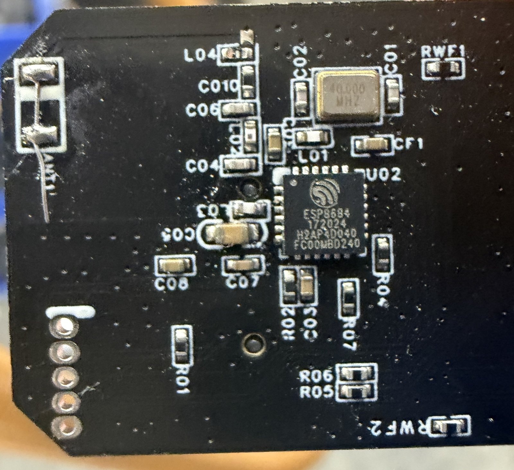
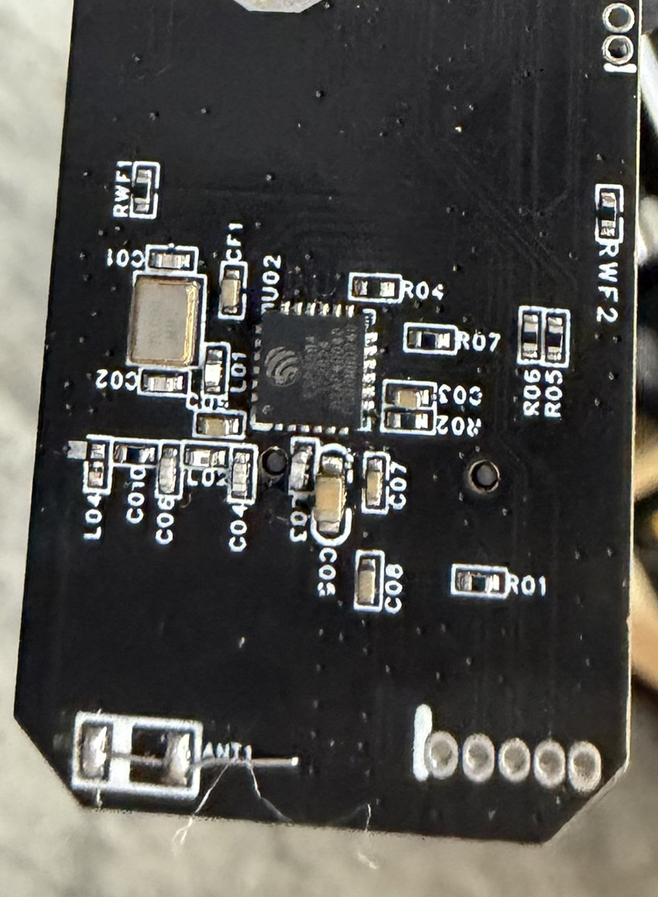
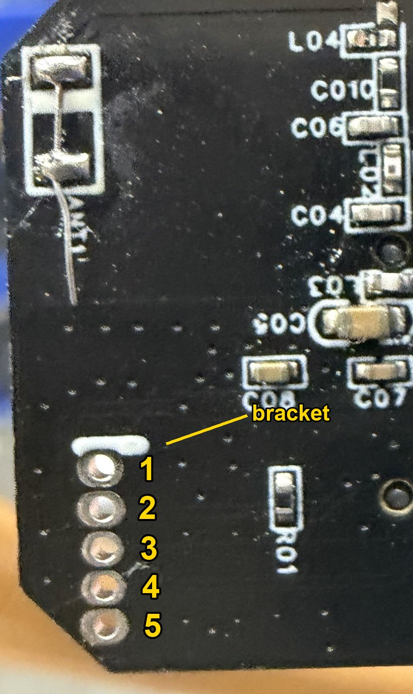

# DroidNet-HoloFan

Replacement firmware for the ESP32-C2 inside a Pixel Arc Atom PRO holofan
(made by Missyou, sold for the "5D HoLo" app, model F-S12). It turns the fan
into a node (id 16, alias "HoloFan") on Greg Hulette's WCB ESP-NOW mesh, so a
droid controller can drive it like any other part of the droid: play, pause,
next, previous, clip by number, volume, brightness, loop, Bluetooth off. In
maintenance mode the fan joins your Wi-Fi for clip uploads and over-the-air
updates, and a bad update rolls itself back.

The fan's LED and SD-card controller keeps its own firmware; only the radio
chip's software is replaced, and your backup of the stock firmware puts it
back.

Its companion is
[DroidNet-HoloLifter](https://github.com/travisccook/DroidNet-HoloLifter), a
motorized lift that raises the fan out of an astromech dome and switches its
power.

---

## Standing on shoulders

None of this would exist without people who took these fans apart first and
wrote down what they found.

- **David Smith (daveismith): beancell-holo**
  <https://github.com/daveismith/beancell-holo>. His documentation of the 5D
  fans' access point and their HTTP and WebSocket control protocol
  (docs/display-protocol.md in his repo) was the key that started this
  project.
- **Greg Hulette: the Wireless Communication Board (WCB)**
  <https://github.com/greghulette/Wireless_Communication_Board-WCB> (GPL-3.0)
  and **WCB_Client** <https://github.com/greghulette/WCBClient> (MIT). The mesh
  the fan joins is Greg's: the boards, the ESP-NOW protocol, acknowledgements,
  retries and device discovery. lib/WcbCore is a port of parts of WCB_Client
  (THIRD_PARTY_NOTICES.md). Thank you, Greg.
- **Oblokos: Holo Fan Toolkit** <https://github.com/Oblokos/holo-fan-toolkit>
  and **ddefino2: Halosmith** <https://github.com/ddefino2/halosmith>,
  clip encoders for other fans of this family. Their work showed how the .bin
  clips are built: polar lines, bit planes, unsigned 8-bit audio at 32 kHz.
- **Zachary McMurrin (zackmcmurrin-dev): holo-fan-linux**
  <https://github.com/zackmcmurrin-dev/holo-fan-linux> (MIT). Our clip
  generator uses the 812-byte clip header he published
  (THIRD_PARTY_NOTICES.md).

---

## Use at your own risk

**Read this before you connect anything to your fan.**

- This is a hobby project, shared as is. Under the GPL-3.0 (sections 15 and 16) it comes with no warranty of any kind. If it bricks your fan, that is on
  the person who flashed it, not on the authors.
- Replacing the fan's firmware may void its warranty.
- A bad flash can leave the fan dead. Your own backup of its stock firmware,
  made with the steps below, is the only way back. Nobody else has it.
- The fan's chips run on 3.3 V. A 5 V adapter, or 5 V on any hole, destroys
  them.
- Never work on the fan while it spins or while its USB-C cable is plugged
  in. The rotor is fast and sharp-edged.
- You need your own WCB mesh. Without one the fan does nothing useful.

Not affiliated with Pixel Arc, Missyou, the makers of the 5D HoLo app,
Espressif, the WCB project or Lucasfilm. Product names belong to their
owners.

---

## What has been tested

One fan: an Atom PRO (model F-S12, stock firmware 1.1.0), in one droid,
since October 2026, updated over Wi-Fi from firmware 0.6 to 0.9.12. Its first
flash went through a SparkFun RedBoard Artemis used as a USB-serial
passthrough (tools/holofan_uart_bridge).

Not tested: any other model, any other USB-serial adapter, a fan without a
WCB mesh. If you try one of these, you are the first.

---

## You will need

- WCB boards on a firmware with ESP-NOW v2 (252-byte packets), and your
  mesh's password, MAC octets 2 and 3, and Wi-Fi channel.
- A USB-serial adapter with 3.3 V logic (check: not 5 V).
- Five male jumper wires or header pins, and some way to hold them in the
  fan's holes without them crossing ("Making contact", below).
- A 330 ohm resistor.
- ESP-IDF at commit 11edebdbbe ("Building", below) and Python 3.

---

## Is my fan compatible?

Three checks, from easiest to definitive. Only the last one is a hard gate.

### 1. Over Wi-Fi

Power the fan normally. A stock fan broadcasts a Wi-Fi network named `5D_`
plus four hex digits (WPA3, password `12345678`). Join it from a computer,
then:

    curl http://192.168.4.1/ctrl/session
    curl http://192.168.4.1/info
    curl "http://192.168.4.1/ctrl/session?action=quit"

The first should answer `{"code":0,"desc":"Session success"}`. A compatible
fan answers the second with `{"model":"F-S12","sw":"1.1.0"}` (the sw version
may differ). The third closes the session.

- `F-S12`: Atom PRO, the tested model.
- `F-S12+`: Atom PRO+. Very likely the same board, but untested, and its clips
  use a different geometry.
- Atom SE: not compatible. One report from an Atom SE says it uses a
  different ESP chip, so this approach does not work on it.
- Anything else: untested. It may have a different board.

### 2. On the rotor

Unplug the fan. Its controller board is at the tail of the rotor arm, in
plain view: nothing has to be opened. Turn the rotor by hand and look for:

- the silkscreen `F_S12+_V1.1`;
- an Espressif `ESP8684` chip next to a `40.000 MHz` crystal;
- a second chip marked `F460JEUA`;
- a microSD slot marked `TF1`;
- a row of five unlabelled holes, with a short white bar printed across
  one end of the row (the pin-1 bracket).

Count the LEDs on the arm: 64 is an Atom PRO (tested); 85 to 90 is a PRO+
(untested); 48 is an Atom SE, which by one report has a different ESP chip
and is not compatible.

### 3. The hard gate

Wired up as in the next section, in download mode:

    python firmware/holofan/fanflash.py check <port>

It must report an ESP32-C2 with 2 MB of flash, and an eFuse gate of no flash
encryption, no secure boot and download mode enabled, ending in `OK`. If it
prints `REFUSED`, stop: this fan cannot take this firmware, and nothing has
been written to it.

---

## Connecting the fan

You only do this once: after the first flash every update goes over Wi-Fi.

### The header

The five holes are on the edge of the rotor arm's tail, next to the
ESP8684, and nothing has to be opened to reach them. Unplug the fan's
USB-C and turn the rotor by hand until the tail faces you.

Hole 1 is the hole at the bracket: the short white bar printed across one
end of the row. That is the end nearer the antenna wire (ANT1). Hole 5 is
at the other end, next to the board's angled corner.

    hole 1  GND
    hole 2  GPIO9   to GND through 330 ohm at power-up = download mode
    hole 3  fan RX  <- adapter TX
    hole 4  fan TX  -> adapter RX
    hole 5  3V3     power for the board (and its LEDs)

There is no reset pin: to reset the chip, remove and reapply 3.3 V. When you
do, disconnect the adapter's TX from hole 3 as well (or unplug the adapter):
a TX line left high can keep the chip partly powered through its RX pin, so
it does not reset cleanly (advice, untested).

### Making contact

No soldering is needed. The pins only have to sit in the holes, each one
touching its own hole and nothing else, while you work. Any way of holding
them there will do:

- What we did: male jumper wires pushed into the holes and held in place
  with hot glue.
- A straight five-pin male header strip, pushed in as one piece, keeps the
  pins parallel and evenly spaced so they cannot cross. Pressed in at a
  slight tilt, the pins bind against the hole walls and hold themselves
  (untested; check first that the strip's 2.54 mm spacing matches the
  holes).
- A spring-loaded pogo-pin clip with five pins at the holes' spacing
  presses onto the holes from one side and needs nothing else (untested).

Whatever you use, look closely before you apply power: no two pins or
wires may touch.

### Wiring

Set the adapter to 3.3 V logic. Then:

    adapter GND  -> hole 1
    adapter TX   -> hole 3
    adapter RX   -> hole 4
    3.3 V        -> hole 5
    hole 2       -> 330 ohm -> GND, only while you power up for download mode

The fan's LEDs run from this 3.3 V rail, so it must handle their inrush when
power is applied. Our 3.3 V source dropped out for about 5 s at every
power-up and then recovered. If your adapter's 3.3 V pin is a small
regulator inside its USB chip, feed hole 5 from a separate 3.3 V supply and
connect that supply's ground to the adapter's ground (advice, untested). The
motor does not run from this rail.

### Step 1: listen

Connect only GND (hole 1) and the adapter's RX (hole 4). Open a serial
terminal at 115200 baud and apply 3.3 V to hole 5. You should see the ROM's
boot log, starting with `ESP-ROM:esp8684`. Nothing at all: check GND, or swap
holes 3 and 4.

### Step 2: download mode

Connect the adapter's TX to hole 3 as well. Remove power, connect the 330 ohm
resistor from hole 2 to GND, and apply 3.3 V again. The boot log now says
`waiting for download`. Close the terminal so the port is free.

### Step 3: check

Load ESP-IDF's environment (installed as in "Building", below), then run the
gate:

    . ~/esp/esp-idf/export.sh
    python firmware/holofan/fanflash.py check <port>

### Step 4: back up the stock firmware

    firmware/holofan/backup_stock.sh <port> ~/fan-backup

This reads the whole 2 MB flash twice and keeps it only if both reads match,
as `stock-<chip MAC>.bin` with a `.json` description next to it. It writes
nothing to the fan and never overwrites an existing backup. Copy the
directory somewhere safe: it is the only way back to stock.

### Step 5: build and flash

    firmware/holofan/build.sh
    firmware/holofan/flash_first.sh <port> ~/fan-backup

flash_first.sh refuses unless ~/fan-backup holds a verified backup of this
very chip. It writes ESP-IDF's rollback bootloader, the partition table,
the OTA data and the app, and never touches the chip's NVS (its RF
calibration and the stock firmware's data stay).

### Step 6: first boot and mesh setup

Remove the resistor from hole 2, then remove and reapply 3.3 V. Open the
serial terminal again (115200, same wires): this is the fan's console. Type
`help`, then enter your mesh's values:

    mesh pw <your mesh password>
    mesh oct <hh> <hh>
    mesh ch <channel>
    mesh restart

For updates over Wi-Fi later, store a Wi-Fi profile too:

    mesh ssid 1 <network name>
    mesh pass 1 <passphrase>

The mesh is off until a password is set, so a fresh fan stays silent.

### Step 7: disconnect

Remove the wires and whatever held them, glue included, so that nothing is
left on the rotor. Then power the fan normally. Within a few seconds of
booting it appears on your WCBs as HoloFan.

---

## Day to day

Send commands through any WCB as `;wHoloFan,<command>` or `;w16,<command>`.
Commands are case-sensitive. Actions never reply; queries reply as a mesh
broadcast that every WCB writes to its broadcast-out ports. Send at most
about three actions a second: the fan's controller needs time between them.

Playback:

    #HLFG<n>        play clip n of the clip list (1-based, the order of #HLFD)
    #HLFT<NN>       play the clip whose name starts with NN- (0-99), e.g.
                    #HLFT03 for 03-Stars.bin
    #HLFP           pause
    #HLFN / #HLFR   next / previous clip
    #HLFL<O|A>      loop one clip / loop all
    #HLFC           re-read the clip list from the SD card

Sound and picture:

    #HLFV<1-3>      volume (the fan starts at 3 after every power-up)
    #HLFM / #HLFU   mute / unmute. There is no volume 0: mute sets volume 1,
                    the lowest, and unmute puts the volume back
    #HLFB<1-3>      brightness
    #HLFW<1|0>      panel switcher on / off
    #HLFA<0|1>      Bluetooth off / on (saved; off by default)

Queries:

    #HLFS  -> #HL:FAN st=<READY|NOMCU> idx=.. name=.. play=.. prog=.. total=.. br=.. vol=.. loop=.. sw=.. err=..
    #HLFD  -> #HL:FANDCIM n=<count> 1=<name> 2=<name> ...

Replies are broadcasts, sent once. From inside a dome many never reach a WCB
in the body, so a missing reply does not mean the fan is off: ask again.

Settings (saved):

    #HLFO<dd>       mesh transmit power in dBm, 02-20 (00 = the default, 8)
    #HLZN<alias>    name on the mesh (after a reboot)
    #HLZI<1-19>     node id (after a reboot)
    #HLZP<0|1>      query replies off / on
    #HLZKS
<hex>  Wi-Fi profile p (1 or 2): network name, in hex
    #HLZKP
<hex>  Wi-Fi profile p: passphrase, in hex (empty = open)
    #HLZX
        maintenance mode on Wi-Fi profile p (below)
    #HLZQ  -> #HL:NODE id=.. name=.. reply=on|off ...

Hex example: the network name "My Home" is 4D7920486F6D65, so
#HLZKS14D7920486F6D65. The console on the programming header (step 6) sets
the same things without hex, and is the only place to set the mesh
password, MAC octets and channel.

The full reference, with the bench and diagnostic commands, is
[docs/SERIAL_COMMANDS.md](docs/SERIAL_COMMANDS.md).

The fan's power is not a fan command: switch it with a relay (the HoloLifter
does this with `#HLF1` / `#HLF0`) or your own switch.

**Clips** for the Atom PRO are 64 LEDs x 520 lines x 6 bits.
tools/holofan_clip/clipgen.py makes them; other geometries play as snow.

[DroidNet Signal Booster](https://github.com/travisccook/DroidNetSignalBooster-releases)
does the clip work without a command line. Its HoloFan tab turns videos
into clips for the Atom PRO, makes new ones in its Create studio, keeps the
library of your clips, puts the ones you pick on the fan's card over Wi-Fi
with one Sync, and gives each clip the command that plays it.

**Maintenance mode** (uploads and updates): send `#HLZX1` (Wi-Fi profile 1),
or power-cycle the fan three times in a row, each time on for 2 to 10 s. The
fan leaves the mesh, joins your Wi-Fi and answers at http://holofan.local:

    python3 tools/bench/clip_put.py 03-Rings.bin http://holofan.local 03-Rings.bin
    curl -X POST -H 'Content-Type: application/octet-stream' \
         --data-binary @firmware/holofan/build/holofan.bin http://holofan.local/api/ota

A new image must reach the mesh within 30 s of booting, or the fan goes back
to the previous one by itself. Maintenance mode has no password: anyone on
that network can upload while it is on. Details:
[docs/MAINTENANCE_API.md](docs/MAINTENANCE_API.md).

---

## Going back to stock

Wire the fan up and put it in download mode (steps 1 and 2), then:

    firmware/holofan/restore_stock.sh <port> ~/fan-backup

It writes your backup of this chip back over the whole flash.

---

## Building

Install ESP-IDF at the commit the stock firmware was built with (ESP-IDF's
own instructions, pinned to one commit):

    mkdir -p ~/esp && cd ~/esp
    git clone --recursive https://github.com/espressif/esp-idf.git
    cd esp-idf
    git checkout 11edebdbbe
    git submodule update --init --recursive
    ./install.sh esp32c2

Then, from this repository:

    firmware/holofan/build.sh

build.sh uses ESP-IDF from ~/esp/esp-idf (or $IDF_PATH), warns if it is at
another commit, and checks that the image fits an OTA slot.

Tests, none of which need hardware:

    pio test -e native
    python3 -B -m unittest discover -s firmware/holofan/tests
    python3 -B -m unittest discover -s tools/bench -p 'test_*.py'
    python3 -B -m unittest discover -s tools/holofan_clip -p 'test_*.py'

---

## How it works

[docs/HOW_IT_WORKS.md](docs/HOW_IT_WORKS.md) describes the two chips, the
header, the UART protocol between them, the SPI clip upload, the clip format,
the flash layout and the volume findings. tools/README.md lists the clip and
bench tools.

The mesh libraries lib/WcbCore, lib/NodeConfig, lib/MaintCore and
lib/LiftCommands are shared with DroidNet-HoloLifter and kept identical in
both repositories.

---

## Licence

GPL-3.0, see [LICENSE](LICENSE). Third-party notices (WCB_Client,
holo-fan-linux, ESP-IDF) are in
[THIRD_PARTY_NOTICES.md](THIRD_PARTY_NOTICES.md).
