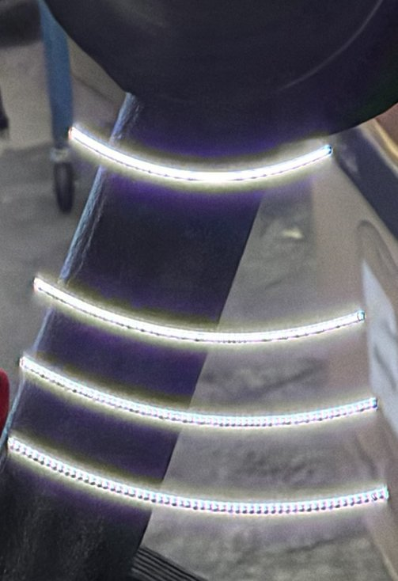
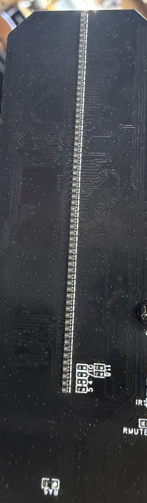

# How the HoloFan works

What this firmware knows about the fan, for anyone who wants to change it or
port it. Everything here was observed on one Pixel Arc Atom PRO (vendor model
F-S12, stock firmware 1.1.0) unless it says "untested". It describes the
fan's wiring and protocols only; it is not a description of the stock
firmware's code.

## 1. Two chips

The fan's controller board (silkscreen F_S12+_V1.1) sits at the tail of the
spinning rotor arm. It carries two processors that share one supply:

- An Espressif ESP8684, which is an ESP32-C2 (revision v1.2): single-core
  RISC-V, Wi-Fi 4 and Bluetooth LE, 40 MHz crystal, 2 MB flash in the
  package. It does the radio and the control. This firmware replaces its
  software.
- A second chip marked F460JEUA, by its marking an HDSC HC32F460 (Arm
  Cortex-M4). It drives the LEDs, reads the clips from the microSD card
  (slot TF1) and plays their audio. This document calls it "the MCU". Its
  firmware is not touched.

The board also has a buck regulator (XL1509), a PCB antenna and a row of five
unlabelled holes, the programming header. The fan is powered through its
USB-C socket; the speaker is in the stationary body.

## 2. The programming header

Five holes in a row. Hole 1 is at the pin-1 bracket, a short white bar
printed across that end of the row, nearer the antenna wire (ANT1); hole
5 is next to the board's angled corner:

    hole 1  GND
    hole 2  GPIO9   strap: held to GND (through about 330 ohm) at power-up
                    = ROM download mode
    hole 3  fan RX  (U0RXD)  <- adapter TX
    hole 4  fan TX  (U0TXD)  -> adapter RX
    hole 5  3V3     feeds the board's logic and the LEDs

There is no EN (reset) pin: a reset means removing and reapplying 3.3 V. The
other boot strap, GPIO8, is not on the header; holding GPIO9 low alone was
enough for download mode on our fan. The ROM prints its boot log on this UART at
115200 baud. Powered from the header, the LEDs light up (their inrush can
make a weak 3.3 V source dip for seconds); the rotor motor does not run.

The eFuses of our fan: no flash encryption, no secure boot, download mode
enabled. That is what makes it possible to read the stock firmware back and
to flash this one. A fan with any of these locked cannot take this firmware
(fanflash.py check refuses it).

## 3. The UART link to the MCU

UART1 at 230400 baud, 8N1: ESP TX on GPIO4, RX on GPIO5 (pull-up), set up
exactly as the stock firmware does. Other lines the ESP drives or reads:

    GPIO3   output, idle high, a ~20 ms low pulse every 2.5 s (heartbeat)
    GPIO10  output, idle high (manual chip select for the SPI upload)
    GPIO18  input with pull-up (the MCU's upload handshake, section 4)

Commands are text lines, `<cmd>[ <arg>...]\n`; the MCU answers with raw text.
A blank line or two (`\n\n`) wakes its parser. The commands this firmware
uses:

    get_setting     -> "setting <ble> <loop> <brightness> <volume> <angle> <model>"
                       e.g. "setting on all 2 3 164 F-S12"
    get_playinfo    -> PlayInfo "<name>" <state> <progress> <total>
    s               list the clips, one name per line
    t <name>        play that clip
    g / h           play / pause
    f / e           next / previous clip
    m <1-3>         volume (there is no 0)
    k <1-3>         brightness
    i / j           loop one / loop all
    c / d           Bluetooth on / off
    a / b           panel switcher on / off
    o <v>           angle
    u <name>        delete a clip
    w <name> <size> create a clip for an upload (answers CT, or CF)
    v               FORMAT THE SD CARD

`v` erases every clip. The firmware sends it only for the maintenance API's
explicit format request (POST /api/card/format?confirm=FORMAT-SD-CARD); it
is refused over the mesh and on the console.

Timing matters. The MCU drops or misreads a line that arrives while it is
still busy with the previous one (a get_setting sent 4 ms after a volume
change once ran as "previous clip"). The firmware therefore waits until the
MCU has been quiet for 300 ms (at most 3 s) after every action, which is why
the mesh commands are queued and paced.

At every power-up the MCU starts at volume 3, Bluetooth on, loop all, and a
clip upload resets it to the same state; after an upload the firmware puts
back the volume, loop mode and brightness it had, and switches Bluetooth to
the saved choice.

## 4. Clip upload over SPI

SPI2 in mode 0 at 40 MHz: MOSI GPIO7, MISO GPIO2, SCLK GPIO6, hardware chip
select on GPIO0 plus the manual one on GPIO10. An upload is:

1. `w <name> <size>` on the UART; the MCU answers `CT` (created) or `CF`.
2. The clip goes out in 1440-byte SPI frames, in windows of 20 frames
   (28,800 bytes). After each window the MCU holds GPIO18 low while it
   stores the window; the ESP counts the low samples, and never lets more
   than one extra window be outstanding (the same handshake the stock
   firmware uses).
3. The last window is padded with zeros to the full 28,800 bytes. The MCU
   ends with `RT` (received) or `RF` (failed).

The MCU aborts a transfer when data stops for roughly 2.6 to 5 s. Wi-Fi from
inside a droid can stall for longer, so the firmware never streams straight
from the network: it stages the clip in the spare OTA partition (about
900 KB ahead of the MCU) and paces the SPI side from there
(docs/MAINTENANCE_API.md, "Resumable upload").

Clip names are `NN-<name>.bin` (NN = a slot number, 0-99, for #HLFT). Clips
shorter than about one second (20 frames) are written but never listed by
the MCU, and cannot then be deleted except by formatting the card: make test
clips at least 30 frames long.

## 5. Clip format (F-S12)

    file    812-byte constant header (starts EE 37; no geometry or length
            in it), then frames, then zeros up to a multiple of 28,800 bytes
    frame   video, then 1,600 bytes of audio
    video   520 lines x 6 bit-planes x 24 bytes = 74,880 bytes
            (64 LEDs x 3 colours = 192 bits = 24 bytes per plane)
    plane   leading zero pad bits (none at 64 LEDs), then for each LED, rim
            first, its blue, green and red bit, most significant bit first;
            plane 0 holds the most significant brightness bit
    audio   unsigned 8-bit mono, 32,000 Hz, 0x80 = silence; 20 frames/s
    total   76,480 bytes per frame

Line 0 points to 3 o'clock and the lines run counter-clockwise (tested with
a spokes clip). The header is the same for every model and is published by
github.com/zackmcmurrin-dev/holo-fan-linux (protocol/ee37-header.bin).

Other models use other geometries, and a clip made for one plays as
shapeless snow on another (tested: an 85x400x6 clip on our 64x520x6 fan):

    Atom PRO   F-S12    64 x 520 x 6    tested
    Atom PRO+  F-S12+   85 x 400 x 6    untested on its own fan
    Atom SE             48 x 300 x 5    untested

tools/holofan_clip/clipgen.py makes clips for any geometry.

## 6. Flash layout and rollback

The first wired flash (firmware/holofan/fanflash.py first) replaces the
stock bootloader and partition table with ESP-IDF's rollback bootloader and
this table:

    nvs       0x009000  0x006000   kept exactly where the stock firmware had it
    ota_0     0x010000  0x0F0000
    ota_1     0x100000  0x0F0000
    otadata   0x1F0000  0x002000

NVS is never erased or written by the flasher. It holds the chip's RF
calibration and the stock firmware's own data, which the stock firmware
needs again if you ever restore it. This firmware keeps its settings in its
own namespace, "hlmesh", and does not let the Wi-Fi driver store anything in
NVS.

After the first flash every update is an OTA in maintenance mode. A new
image boots in the bootloader's pending-verify state and keeps itself only
if it reaches the mesh within 30 s; otherwise the bootloader goes back to the
previous image on its own (tested).

## 7. Transmit power

The ESP's radio shares the fan's supply with the audio. The firmware
transmits on the mesh at 8 dBm by default: on our fan, 20 dBm bursts at
volume 3 caused brownout resets of the ESP, and at 8 dBm normal clips played
clean. `#HLFO<dd>` changes it (02-20 dBm, saved). Maintenance mode (Wi-Fi)
always transmits at 20 dBm, so the fan plays at volume 1 while in maintenance
and restores the volume afterwards.

`#HLFQ` reports the last reset reason (rst=9 is a brownout);
docs/SERIAL_COMMANDS.md has the bench instruments.
